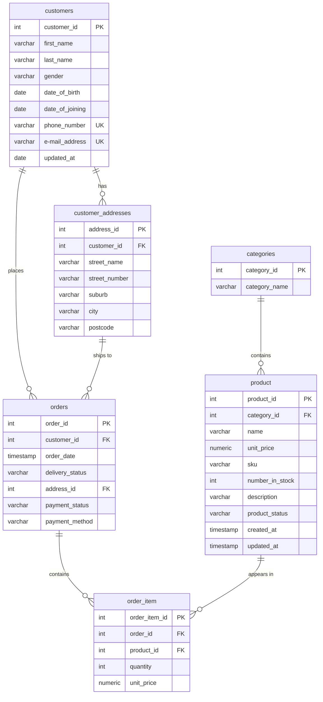

# SQL Retail Project

A PostgreSQL retail database built to answer business questions with SQL

## Tech stack

- PostgreSQL 16
- Python (Faker, faker_commerce)
- git

## Why a relational database

There are several considerations that went into creating this schema when designing it, for example:

- **The data is naturally related:** customers place orders, products belong to orders, orders are shipped to addresses, and products belong to categories. This type of data lends itself to being used in a relational database, where tables and joins go smoothly together.
- **Integrity is enforced by the rules of the database itself:** keys and constraints prevent orphaned orders, invalid inputs or duplicated customers/orders.
- **SQL is an ideal tool for this analysis:** joins, window functions and aggregations all help to answer this project's business questions.
- **The project reflects real working environments:** retail and e-commerce systems typically run on relational databases; this project is reflective of those requirements.

## Schema



For each of the tables in this relational database, primary keys are used to identify each row of data. To ensure that each key is unique, and therefore to prevent duplications or clashes, I have used `GENERATED ALWAYS AS IDENTITY`. This ensures that when creating a row, PostgreSQL automatically assigns a unique ID.

The six tables created for the purpose of this data are as follows:

- **`customers`:** contains all information relating to the customer themselves. Each customer is provided with a unique ID which acts as a primary key for the table; additionally, all phone numbers and e-mail addresses of customers are unique for each row.
- **`customer_addresses`:** these are the saved addresses of customers. Each address has a unique address ID, and this is related to the customer via the customer ID. This means a customer can have no address, one address or several addresses, and an address can exist without a customer related to it. Orders reference the specific address they are shipped to. In the generated data, customers without an address do not place orders.
- **`categories`:** by having categories within its own separate data table, it makes adding, changing or removing categories as simple as possible.
- **`product`:** each product has a unique ID, and is related to the categories table via the category ID. This table holds data such as price, quantity in stock and the status of the product. Product status is limited to either being active or discontinued, as I used a `CHECK` constraint to limit the range of valid inputs for this column. Unit price uses `NUMERIC(10,2)` to avoid the rounding errors of floating-point types.
- **`orders`:** all orders have their own unique ID and have two foreign keys: customer ID and address ID. Outside of that, the table contains the order date, delivery status, payment status and payment method. Delivery status, payment status and payment method all have `CHECK` constraints to improve the integrity of the data within the table. Order totals are not stored in this table; they are calculated from `order_item`, so there is a single source of truth and totals can never drift out of sync with the line items.
- **`order_item`:** links to orders and products. An order can contain multiple products and a product can appear in multiple orders. Order item helps to resolve this issue as we have one row per product per order, with the quantity of items ordered. We also store unit price in this table. The reason behind having unit price here, rather than just using the unit price in the product table, is that the final price a customer pays might be different to the standard price of the product, due to, say, a sale. Therefore, when calculating the total revenue generated by a product, we want to use the unit price in this table.

## Project structure

- `schema/`
  - `01_create_tables.sql` → responsible for creating the tables that have been discussed earlier in this README
  - `02_views.sql` → creates views that are used in queries within this project
  - `03_indexes.sql` → creates indexes for `order_item.product_id`, `orders.customer_id` and `orders.order_date`
- `data/`
  - `02_seed_data.sql` → responsible for inserting the data generated by the `generate_seed_data.py` script into the tables
- `queries/`
  - `01_basic_queries.sql` → provides simple insights into the dataset, such as the age and gender makeup of customers
  - `02_joins.sql` → uses both inner and left joins to provide greater insights into the data set. Joins are used both within the main query and subqueries
  - `03_ctes_subqueries.sql` → implements CTEs to answer business questions like whether there are discontinued products worth reviving, based on sales data
  - `04_window_functions.sql` → `LAG()` helps us to create a month-over-month revenue trend, while `RANK()` shows us the largest orders by value or quantity
  - `05_explain.sql` → this file was used to take pre-existing queries and test their performance based on implementing indexing
- `analysis/`
  - This folder contains two text files: `explain_before.txt` and `explain_after.txt`. These text files were used to test the performance of queries before and after implementing indexing on our tables.
- Misc
  - `generate_seed_data.py` → the file where I created the data used within the data tables, using the Faker library

## Setup

### Prerequisites

- PostgreSQL 16
- Python 3

### Steps

Replace `<username>` with your PostgreSQL role. Run all commands from the project root.

1. **Clone the repository**
   ```bash
   git clone https://github.com/serve2623/SQL-Retail-Project.git
   cd SQL-Retail-Project
   ```

2. **Create the database**
   ```bash
   psql -U <username> -h localhost -d postgres -c "CREATE DATABASE retail_project;"
   ```

3. **Create the tables**
   ```bash
   psql -U <username> -h localhost -d retail_project -f schema/01_create_tables.sql
   ```

4. **(Optional) Regenerate the seed data**

   `data/02_seed_data.sql` is already included. To generate a new random dataset instead:
   ```bash
   python3 -m venv venv
   source venv/bin/activate
   pip install faker faker_commerce
   python3 generate_seed_data.py
   ```

5. **Load the data**
   ```bash
   psql -U <username> -h localhost -d retail_project -v ON_ERROR_STOP=1 -f data/02_seed_data.sql
   ```

6. **Create the views and indexes, then refresh statistics**
   ```bash
   psql -U <username> -h localhost -d retail_project -f schema/02_views.sql
   psql -U <username> -h localhost -d retail_project -f schema/03_indexes.sql
   psql -U <username> -h localhost -d retail_project -c "ANALYZE;"
   ```

7. **Run the queries**
   ```bash
   psql -U <username> -h localhost -d retail_project -P pager=off -f queries/01_basic_queries.sql
   ```
   Repeat for the other files in `queries/`.

### Reloading the data

To reset the tables before reloading:

```bash
psql -U <username> -h localhost -d retail_project -c "TRUNCATE customers, customer_addresses, categories, product, orders, order_item RESTART IDENTITY CASCADE;"
```

## Business questions

I've broken down the questions I've posed to myself by each file that exists within the `queries/` folder.

### `01_basic_queries.sql`

- Assessing the demographic makeup of the customers, specifically looking at age and gender
- Figure out which cities orders are shipped to
- Calculate the average value of orders, broken down by payment method

### `02_joins.sql`

- Which product categories generate the most revenue?
- Which customers haven't ordered from the business for over past 6 months?
- What are the top 10 most purchased items by quantity of products ordered?
- What are the highest revenue-generating products?

### `03_ctes_subqueries.sql`

- Do customers make repeat purchases of the same items? A repeat purchase is defined as the same customer buying the same product in two or more separate orders.
- Are there discontinued products worth reviving, based on sales data?

### `04_window_functions.sql`

- Provide a month-over-month revenue trend
- Work out the largest orders, either by value or item count
- How new products are performing versus others in their category
- Which customers buy most frequently

## Sample output

## Limitations

There are a number of limitations with this project that are worth flagging. Primarily, the biggest limitation is the use of synthetic data, which carries many consequences. As this data is generated rather than being authentic, it does not contain the messiness that real-world data has, such as outliers, edge cases and general randomness. For example, in our seed data, dates and products are assigned uniformly at random, so we lack the seasonality that would normally occur with consumer behaviour. The relationships between data points may also not reflect those we see in the real world, and it is difficult to validate how accurate the synthetic data is, so we cannot draw definite conclusions from the analysis.

Within our script for generating data, orders can only be made between January 2024 and June 2026. Therefore, any query that uses `NOW()` will have a limited output depending on when it is run.

With the query looking into how new products are performing against other products in their categories, the new products are included in the average we made to compare against. To improve the robustness of this piece of analysis, we should exclude the new products from the average.

Due to the size of the data tables we are looking at, the indexes created in `03_indexes.sql` are not used, which means the performance benefits we would see from queries run on larger data sets are not replicated in this project.

## Link to article
